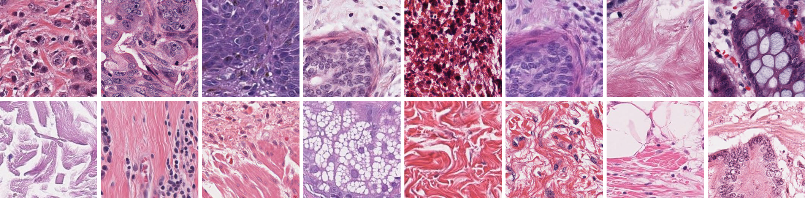
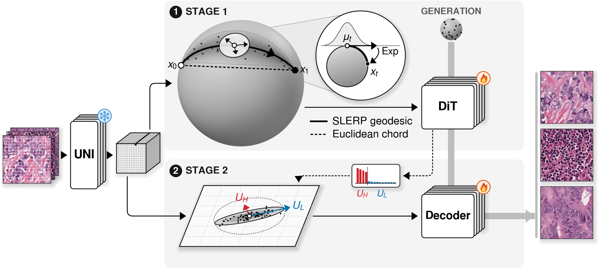

<div align="center">

# 🌊 STREAM: Stochastic Riemannian Flow Matching with Anisotropic Decoder for Digital Histopathology Image Generation

Won June Cho, Daeky Jeong, Hyeongyeol Lim, Hongjun Yoon

DEEPNOID Inc.

**NeurIPS 2026 Spotlight**

[](https://chokevin8.github.io/STREAM-Patho/)
[](https://arxiv.org/abs/2606.07036)

</div>

<p align="center">
  
</p>

<p align="center">
  
</p>

Existing state-of-the-art histopathology generative models use VFMs only as conditioning, and
most of their output diversity comes from that signal. STREAM instead makes the ℓ2-normalized
patch tokens of a frozen VFM the latent space itself and learns their distribution there, with
Riemannian flow matching (RFM) on the hypersphere. STREAM makes two novel contributions: a
stochastic bridge added to Diffusion Transformer (DiT) training and anisotropic noise added to
decoder training. With these two contributions, and with every baseline comparison method using
the same UNI encoder, STREAM achieves state-of-the-art gFID on TCGA-BRCA, TCGA-COADREAD and
SPIDER-skin.

**We highly recommend reading the [project page](https://chokevin8.github.io/STREAM-Patho/) and/or the [paper](https://arxiv.org/abs/2606.07036) before implementing STREAM.**

This repository contains:

* A PyTorch implementation of the STREAM DiT and of the anisotropic pixel decoder.
* Training scripts for Stage 1 (DiT), the spectral basis extraction and Stage 2 (anisotropic decoder).
* Generation and gFID / rFID evaluation implementation.

## Environment

### Dependency Setup

1. Clone the repository:
   ```bash
   git clone https://github.com/chokevin8/STREAM.git
   cd STREAM
   ```

2. Create the environment with conda (Python 3.12, PyTorch 2.8.0 with CUDA 12.8, pinned packages):
   ```bash
   conda env create -f environment.yml
   conda activate stream
   ```

   or with pip:
   ```bash
   pip install -r requirements.txt --extra-index-url https://download.pytorch.org/whl/cu128
   ```

   `torch.compile` needs a C/C++ compiler: the conda environment installs one; with pip,
   install `gcc`/`g++` on the system.

3. Check the installation (from the repository root, on a GPU machine):
   ```bash
   # PyTorch, CUDA and bf16 support
   python -c "import torch; print(torch.__version__, torch.version.cuda, torch.cuda.is_available(), torch.cuda.is_bf16_supported())"
   # all entry points import
   python -c "import stream.train_dit, stream.train_decoder, stream.evaluate, stream.extract_svd, stream.extract_uni_features, stream.kmeans_centroids, stream.merge_svd, stream.build_matched_index; print('imports OK')"
   # torch.compile works
   python -c "import torch; f = torch.compile(lambda x: x * 2); print(f(torch.ones(4, device='cuda')))"
   ```

Run all commands from the repository root. Every entry point lists its options with `--help`.

## Data & Model Preparation

### Pretrained Models

* **UNI** (`MahmoodLab/uni`, gated): request access on
  [the model page](https://huggingface.co/MahmoodLab/uni), then log in with
  `huggingface-cli login` or `export HF_TOKEN=<your token>`. The weights go to the Hugging Face
  cache (`HF_HOME`).
* **Kaiko ViT-S/8** (discriminator backbone): loaded with `torch.hub` from
  `kaiko-ai/towards_large_pathology_fms`, pinned to a fixed commit whose `hubconf.py` downloads
  the weights of release `0.0.1`.
* **VGG16 and LPIPS** (perceptual loss) and **Inception V3** (FID): downloaded automatically
  (torchvision, the LPIPS weight file with an MD5 check, and torch-fidelity) into `TORCH_HOME`.

To pre-download everything (for example for offline compute nodes):

```bash
python -c "
import torch
from torchmetrics.image.fid import NoTrainInceptionV3
from stream.discriminator import KAIKO_HUB_REPO
from stream.lpips import LPIPS
from stream.uni import load_uni
load_uni()
torch.hub.load(KAIKO_HUB_REPO, 'vits8', trust_repo=True, skip_validation=True)
LPIPS()
NoTrainInceptionV3(name='inception-v3-compat', features_list=['2048'])
"
```

Then copy the `HF_HOME` and `TORCH_HOME` directories to the offline machine, point the two
variables at them and set `HF_HUB_OFFLINE=1`.

### Prepare Dataset

1. **Patches.** Put 256 x 256 RGB patches (`.png`, `.jpg` or `.jpeg`; 20x for the provided
   config) in one directory, flat or with one level of sub-folders.

2. **UNI features.** Extract the frozen UNI tokens (256 tokens x 1024 per patch, float16
   safetensors shards):
   ```bash
   torchrun --nproc_per_node=8 -m stream.extract_uni_features \
       --image-dir path/to/patches \
       --output-dir path/to/uni_features
   ```
   `--batch-size` (512) and `--num-workers` (8) are per GPU, `--shard-size` (10000) is the
   number of patches per shard, and `--max-depth` (2) is the number of directory levels scanned
   (1 for a flat directory). Re-running the same command resumes after the existing shards.

3. **Matched index.** Pair every feature row with its image file (needed by the decoder and by
   rFID):
   ```bash
   python -m stream.build_matched_index \
       --uni-embedding-path path/to/uni_features \
       --image-dir path/to/patches
   ```
   This writes `matched_index.json` into the feature directory.

## Configuration

All hyper-parameters are in one YAML file; paths are given on the command line only.
`configs/brca.yaml` is the TCGA-BRCA setting of the paper.

<details>
<summary>All configuration keys (<code>configs/brca.yaml</code>)</summary>

| Key | Value | Meaning |
|---|---|---|
| **`model`** | | DiT architecture (used by `train_dit`, `extract_svd`, `evaluate`; must match the DiT checkpoint) |
| `input_dim` | 1024 | UNI token dimension (also the decoder input width) |
| `num_tokens` | 256 | tokens per patch (16 x 16) |
| `hidden_size` | 1152 | transformer width |
| `depth` | 28 | transformer blocks |
| `num_heads` | 16 | attention heads |
| `mlp_ratio` | 4.0 | feed-forward width factor |
| **`transport`** | | Stage 1 objective (used by `train_dit`) |
| `sigma_max` | 0.01 | bridge noise scale, noise level `sigma_max * sin(pi t)` |
| `logit_normal_mu` | -0.5 | mean of the logit-normal time distribution `t = sigmoid(N(mu, s^2))` |
| `logit_normal_s` | 1.0 | standard deviation of the logit-normal time distribution |
| `eps_t` | 1.0e-05 | sampled times are clamped to `[eps_t, 1 - eps_t]` |
| `min_one_minus_t` | 0.001 | floor of `(1 - t)` in the `1 / (1 - t)^2` loss weight |
| **`dit_train`** | | Stage 1 optimization (used by `train_dit`) |
| `seed` | 42 | base random seed |
| `global_batch_size` | 1024 | samples per optimizer step over all GPUs (`--global-batch-size` overrides) |
| `max_steps` | 95000 | optimizer steps (`--max-steps` overrides) |
| `lr` | 0.0004 | AdamW learning rate, constant after warmup |
| `betas` | [0.9, 0.95] | AdamW betas |
| `weight_decay` | 0.0 | AdamW weight decay |
| `warmup_steps` | 5000 | linear learning-rate warmup steps |
| `max_grad_norm` | 5.0 | gradient-norm clipping |
| `ema_decay` | 0.9999 | EMA decay per step (EMA weights are used downstream) |
| `num_workers` | 8 | data-loading workers per GPU |
| `ckpt_every` | 5000 | checkpoint interval in steps |
| **`decoder`** | | pixel decoder architecture, RAE ViT-XL decoder (used by `train_decoder`, `evaluate`; must match the decoder checkpoint) |
| `decoder_hidden_size` | 1152 | decoder width |
| `decoder_num_hidden_layers` | 28 | decoder depth |
| `decoder_num_attention_heads` | 16 | decoder attention heads |
| `decoder_intermediate_size` | 4096 | decoder feed-forward width |
| `image_size` | 256 | output image size in pixels |
| `patch_size` | 16 | pixels per token side |
| **`decoder_train`** | | Stage 2 optimization (used by `train_decoder`) |
| `seed` | 42 | random seed |
| `global_batch_size` | 512 | samples per step over all GPUs (`--global-batch-size` overrides) |
| `max_steps` | 90000 | training steps (`--max-steps` overrides); phases and schedules scale with it |
| `num_workers` | 8 | data-loading workers per GPU |
| `warmup_steps` | 3000 | linear warmup of the decoder learning rate |
| `lr` | 0.0002 | decoder AdamW peak learning rate (cosine decay) |
| `final_lr` | 2.0e-05 | decoder learning rate at the end of the decay |
| `weight_decay` | 0.05 | decoder AdamW weight decay |
| `disc_lr` | 0.0002 | discriminator-head AdamW peak learning rate (cosine decay) |
| `disc_final_lr` | 2.0e-05 | discriminator learning rate at the end of the decay |
| `ema_decay` | 0.9978 | EMA decay of the decoder weights (EMA weights are used for evaluation) |
| `lambda_l1` | 1.0 | weight of the L1 loss |
| `lambda_lpips` | 0.5 | weight of the LPIPS loss |
| `lambda_cos` | 0.5 | weight of the UNI cosine round-trip loss |
| `omega_G` | 0.75 | weight of the adversarial loss (times the adaptive weight) |
| `disc_upd_start_frac` | 0.175 | fraction of `max_steps` at which discriminator training starts |
| `gan_start_frac` | 0.2 | fraction of `max_steps` at which the adversarial loss is switched on |
| `sigma_H` | 0.002 | noise standard deviation along the top-k* spectral directions |
| `sigma_L` | 0.02 | noise standard deviation along the remaining tangent directions |
| `energy_threshold` | 0.9 | k* = smallest k whose cumulative spectral energy reaches this fraction |
| `ckpt_every` | 5000 | checkpoint interval in steps |
| **`sampling`** | | generation (used by `evaluate`) |
| `num_steps` | 25 | midpoint sampler steps (50 DiT evaluations) |

</details>

**A config for a new dataset.** Copy `configs/brca.yaml` and keep the architecture and the
objective. Set `max_steps` (and, if needed, `global_batch_size`) of `dit_train` and
`decoder_train` for your dataset size and budget; `num_workers` and `ckpt_every` can be chosen
freely. The code is written for UNI tokens; with another encoder, adapt `stream/uni.py` and keep
`model.input_dim` equal to the token dimension and `(image_size / patch_size)^2` equal to
`model.num_tokens`.

## Stage 1: DiT

### Training

```bash
accelerate launch --num_processes 8 --num_machines 1 --mixed_precision no \
    -m stream.train_dit \
    --config configs/brca.yaml \
    --uni-embedding-path path/to/uni_features \
    --output-dir path/to/dit_run
```

* `--config`: the YAML config (sections `model`, `transport`, `dit_train`).
* `--uni-embedding-path`: the directory of UNI feature shards.
* `--output-dir`: the run directory; `log.txt` and `checkpoints/` (`0005000.pt`, ...,
  `final_0095000.pt`) are written there.
* Optional: `--global-batch-size` and `--max-steps` override the config;
  `--gradient-accumulation-steps` (1) splits each optimizer step into micro-batches.

Keep `--mixed_precision no` (the DiT trains in float32 with TF32). Both trainers also log to
Weights & Biases (`WANDB_MODE=disabled` turns it off).

**Resuming.** Re-run the same command: training continues from the checkpoint with the highest
step in `<output-dir>/checkpoints/`.

## Spectral Basis Extraction (Jacobian SVD Cache)

```bash
bash scripts/run_svd.sh \
    --config configs/brca.yaml \
    --dit-checkpoint path/to/dit_run/checkpoints/final_0095000.pt \
    --uni-embedding-path path/to/uni_features \
    --output-dir path/to/svd
```

* `--config`: the config whose `model` section matches the DiT checkpoint.
* `--dit-checkpoint`: the Stage 1 checkpoint (its EMA weights are used).
* `--uni-embedding-path`: the UNI feature shards of the training data.
* `--output-dir`: receives `centroids.pt`, the partial SVD files and the merged
  `per_token_svd_cache.pt` used by Stage 2.
* Optional (defaults are the paper setting): `--n-centroids` (50), `--n-features` (50000),
  `--svd-m` (600), `--svd-t-eval` (0.99), `--jvp-chunk-size` (5), `--num-gpus` (8).

This step runs between Stage 1 and Stage 2. The script runs k-means (`stream.kmeans_centroids`),
one per-token Jacobian SVD worker per GPU (`stream.extract_svd`) and the merge (`stream.merge_svd`).

**Resuming.** If a worker fails, re-run `stream.extract_svd` for its `--centroid-start` /
`--centroid-end` range, then `python -m stream.merge_svd --partial-dir path/to/svd --output-path path/to/svd/per_token_svd_cache.pt`.

## Stage 2: Anisotropic Decoder

```bash
torchrun --nproc_per_node=8 -m stream.train_decoder \
    --config configs/brca.yaml \
    --uni-embedding-path path/to/uni_features \
    --image-dir path/to/patches \
    --svd-cache path/to/svd/per_token_svd_cache.pt \
    --output-dir path/to/decoder_run
```

* `--config`: the YAML config (sections `model`, `decoder`, `decoder_train`).
* `--uni-embedding-path`: the UNI feature shards with `matched_index.json`.
* `--image-dir`: the patch directory the matched index refers to.
* `--svd-cache`: the merged spectral basis from the spectral basis extraction.
* `--output-dir`: the run directory; `train.log` and `checkpoints/` (`step-XXXXXX.pt`,
  `epoch-XXX.pt`, `decoder_final.pt`) are written there.
* Optional: `--global-batch-size` and `--max-steps` override the config.

Use `torchrun` also on one GPU. Decoder training uses bf16 autocast and needs a bf16-capable GPU.

**Resuming.** Add `--resume path/to/decoder_run/checkpoints/step-045000.pt` to the same command.

## Generation and Evaluation

### Sampling

```bash
CUDA_VISIBLE_DEVICES=0 python -m stream.evaluate \
    --config configs/brca.yaml \
    --dit-checkpoint path/to/dit_run/checkpoints/final_0095000.pt \
    --decoder-checkpoint path/to/decoder_run/checkpoints/step-090000.pt \
    --output-dir path/to/samples \
    --num-gen 500 --seed 1000 --generate-only
```

* `--dit-checkpoint`, `--decoder-checkpoint`: the trained models (EMA weights are used).
* `--output-dir`: receives `gen_png/` (256 x 256 PNGs) and `features_gen.pt` (the generated
  UNI tokens).
* `--num-gen` (50000), `--batch-size` (512), `--seed` (42): number of images, sampling batch size
  and seed.
* `--generate-only`: stop after writing the images.

### Evaluation

```bash
CUDA_VISIBLE_DEVICES=0 python -m stream.evaluate \
    --config configs/brca.yaml \
    --dit-checkpoint path/to/dit_run/checkpoints/final_0095000.pt \
    --decoder-checkpoint path/to/decoder_run/checkpoints/step-090000.pt \
    --gt-dir path/to/reference_images \
    --gt-uni-embedding-path path/to/reference_uni_features \
    --reference-stats path/to/reference_inception.npz \
    --output-dir path/to/eval
```

* `--gt-dir`: 50k or more reference images for FID calculation.
* `--gt-uni-embedding-path`: the UNI features and matched index of exactly these images; the
  decoder reconstructs them for rFID. Extract the UNI features of the reference images and build
  their matched index with the two commands in Prepare Dataset (`--max-depth 1` for the feature extraction).
* `--reference-stats`: cache of the reference Inception features; computed from `--gt-dir` if
  the file does not exist, reused as it is otherwise (default:
  `<output-dir>/reference_inception_features.npz`).

Generated images and reconstructions are written as image files and read back through the same
Inception pipeline as the reference images. gFID and rFID are written to
`<output-dir>/results.json`. Outputs that already exist in `--output-dir` are reused, so use a
new output directory for every model.

## Acknowledgement

This code builds on the following repositories:

* [RAE](https://github.com/bytetriper/RAE): the ViT decoder and the discriminator design.
* [LightningDiT](https://github.com/hustvl/LightningDiT): the DiT implementation.
* [UNI](https://github.com/mahmoodlab/UNI) (MahmoodLab): the frozen pathology encoder.
* [Kaiko](https://github.com/kaiko-ai/towards_large_pathology_fms) (kaiko-ai): the discriminator backbone.
* [LPIPS](https://github.com/richzhang/PerceptualSimilarity): the perceptual loss.
* [torch-fidelity](https://github.com/toshas/torch-fidelity) and [pytorch-fid](https://github.com/mseitzer/pytorch-fid): the FID Inception network.

## License

The code and documentation are under CC BY-NC-SA 4.0 (see `LICENSE`): share and adapt for
non-commercial use, with attribution, under the same license. Vendored code and the pretrained
models downloaded at run time keep their own licenses and terms (UNI and Kaiko are
non-commercial).

## Pretrained Checkpoints

The TCGA-BRCA checkpoints are available on request only. Please send an email to [wjcho@deepnoid.com](mailto:wjcho@deepnoid.com) or [chokevin8@gmail.com](mailto:chokevin8@gmail.com).

## Citation

```bibtex
@inproceedings{cho2026stream,
  title     = {{STREAM}: Stochastic Riemannian Flow Matching with Anisotropic Decoder for Digital Histopathology Image Generation},
  author    = {Cho, Won June and Jeong, Daeky and Lim, Hyeongyeol and Yoon, Hongjun},
  booktitle = {The Fortieth Annual Conference on Neural Information Processing Systems},
  year      = {2026},
  url       = {https://arxiv.org/abs/2606.07036}
}
```
